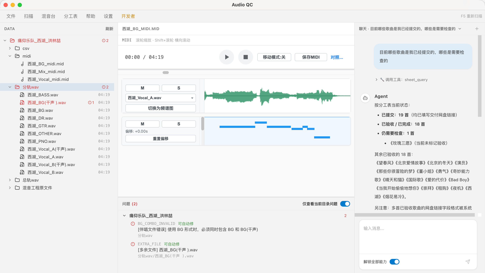

# Audio QC

面向音频数据验收的桌面质检工具，支持文件结构与命名检查、音频试听、MIDI 和 CSV 查看，并通过 Agent 协助安排检查、记录问题和跟进每首歌的进度。

**当前版本：2.0 Beta** · 支持 Windows 和 macOS

[下载 Beta 版](https://github.com/nianyucatfish/checker/releases/tag/v2.0.0-beta) · [全部版本](https://github.com/nianyucatfish/checker/releases) · [反馈问题](https://github.com/nianyucatfish/checker/issues)



左侧查看文件与检查结果，中间对照 MIDI 和音频，右侧通过智能体查询分工表并推进质检。

## 快速开始

### 1. 下载并打开

普通使用无需安装 Python、Node.js 或克隆仓库。

| 系统 | 下载文件 | 打开方式 |
| --- | --- | --- |
| Windows（Intel / AMD） | `windows-x64-portable.zip` | 完整解压，双击 `Audio QC.exe` |
| Mac（Apple 芯片） | `macos-arm64-unsigned.dmg` | 将 Audio QC 拖入 Applications |
| Mac（Intel 芯片） | `macos-x64-unsigned.dmg` | 将 Audio QC 拖入 Applications |

Windows 请保留解压后的整个文件夹，不要单独移动 exe，也不要直接在压缩包里运行。当前未提供 Windows ARM 原生包。

macOS 当前版本未经 Apple Developer ID 签名和公证。如果首次打开被拦截，按 DMG 内的 **「首次打开说明.txt」** 操作，其中包含打开终端的方法；也可[在线查看说明](packaging/macos/首次打开说明.txt)。首次启动需要准备本地服务，请等待启动提示完成。

### 2. 配置模型

打开 **设置 → LLM API**，依次填写：

1. **协议**：按模型服务商提供的接口选择。
2. **Endpoint**：填写服务商提供的接口地址。
3. **API Key**：填写你的模型服务密钥。
4. **模型**：点击获取按钮拉取列表并搜索选择，也可以手动填写模型名称。

保存后点击 **测试连接**。Agent 需要可用的模型配置；不使用 Agent 时，仍可查看本地文件。

### 3. 接入分工表（按需）

如果你参与使用本项目分工表的验收工作，打开 **设置 → 分工表 · 用户**：

- 填写或确认管理员提供的服务器地址。
- 填写管理员下发的 **表格密钥**。
- 填写你在表中的 **验收负责人姓名**，用于“仅查看我负责的歌曲”筛选。

保存后可测试配置。顶部 **分工表** 菜单支持查看、复制、刷新，以及按负责人和验收状态筛选。无需配置腾讯文档开发者账号。

未配置分工表时仍可检查本地文件，表格字段需人工核对。分工表和流程提示词通过 HTTPS 获取，请求固定直连，不使用系统 HTTP 代理；TUN／虚拟网卡代理仍可能接管网络流量。

### 4. 选择目录，开始质检

选择包含歌曲文件夹的工作目录，在左侧文件列表中查看歌曲和检查结果。工作区通常是这样的结构：

```text
工作目录/
├── 歌手_歌曲_扒曲人/
│   ├── 分轨wav/
│   ├── 总轨wav/
│   ├── midi/
│   ├── csv/
│   └── 混音工程原文件/
└── 另一首歌曲文件夹/
```

在 Agent 对话中说明要检查的歌曲和范围，例如：

> 查看分工表中我负责的未验收歌曲。
>
> 检查当前工作区的《某首歌》，先检查文件结构和命名。
>
> 继续检查这首歌，告诉我还有哪些需要人工确认。

Agent 可以筛选查询全表，默认查看未验收歌曲，结果较多时分页返回。一个会话可检查多首歌，每首歌的进度独立保存并跨会话共享。试听和其他人工判断按界面提示确认；上传、填链接和最终验收标记仍需人工完成。

### 5. 安装浏览器插件（按需）

需要 Agent 操作浏览器时，在同一个 [Release 下载页](https://github.com/nianyucatfish/checker/releases/tag/v2.0.0-beta) 下载 **`GA-Browser-Bridge-2.0.0-beta.zip`**：

1. 解压 ZIP，保留其中的 `browser-bridge` 文件夹。
2. Chrome 打开 `chrome://extensions`（Edge：`edge://extensions`），开启 **开发者模式**。
3. 点击 **加载已解压的扩展程序**，选择 `browser-bridge` 文件夹。
4. 打开 Audio QC，在插件弹窗中确认连接状态。

已有旧版时先停用旧版，避免两个桥接插件同时运行。插件支持 GA 及兼容客户端，包内附有安装说明、来源记录和 MIT 许可证。

### 6. 使用 Codex / Claude 等外部 Agent

2.0 Beta 起支持外部 Agent 接口。先打开软件，再解压配套的 `Audio-QC-Agent-Skill-<版本>.zip`，保留整个 `audio-qc` 文件夹。CLI 需要本机安装 Python 3.9+，无需额外 Python 包，也无需配置软件内置模型。

**最简单：不安装 Skill，直接告诉本地 Agent：**

> 阅读 `/路径/audio-qc/SKILL.md`，按照其中的说明，使用 CLI 完成质检。

把路径替换为解压后的实际位置，例如 Windows 的 `C:\Users\你的用户名\Downloads\audio-qc\SKILL.md`。Agent 需要能读取本机文件、运行命令并连接本机服务。

**希望以后直接调用：** 将整个 `audio-qc` 文件夹放到对应目录（目录不存在时新建）：

| Agent | macOS / Linux 个人技能目录 | Windows 原生个人技能目录 | 发起任务 |
| --- | --- | --- | --- |
| Codex 本地客户端（桌面端 / CLI / IDE） | `~/.agents/skills/audio-qc/` | `%USERPROFILE%\.agents\skills\audio-qc\` | 选择 `audio-qc` 技能，或输入 `$audio-qc` 并描述任务 |
| Claude Code 本地会话（终端 / IDE / 桌面 Code） | `~/.claude/skills/audio-qc/` | `%USERPROFILE%\.claude\skills\audio-qc\` | 输入 `/audio-qc` 并描述任务 |

安装后确认 `audio-qc/SKILL.md` 和 `audio-qc/scripts/qc.py` 都存在。若未出现，重新打开 Agent 或新建会话。Windows 的 `%USERPROFILE%` 可粘贴到资源管理器地址栏，macOS 的 `~` 表示个人主目录。

Claude 网页聊天、Cowork 和云端会话的安装方式及连接限制不同；本工具推荐使用能访问本机的 Codex 或 Claude Code 本地会话。详见 [各平台安装与使用](doc/外部Agent接入.md#各平台安装-skill)。安装路径和调用方式参考 [Codex 官方说明](https://learn.chatgpt.com/docs/build-skills)及 [Claude Code 官方说明](https://code.claude.com/docs/en/skills)。

## 常用功能

- **文件检查**：查看命名、结构、格式与时长等问题，并按检查结果处理。
- **音频与标注预览**：试听音频、使用混音台、查看 MIDI 和 CSV。
- **Agent 质检**：根据流程组织检查，记录每首歌的完成项与遗留问题。
- **分工表查询**：筛选未验收／已验收、本人负责的歌曲，也可让 Agent 按歌名、原唱或流派查找。Agent 获取的人员姓名会打码，网盘链接完整返回。
- **高级工具**：按需开启聊天区的“解锁全部能力”，提供 Python、浏览器和文件工具；开关在重启和切换会话后保留。常规质检无需开启。
- **离线更新**：在设置中选择同系统、同架构且版本更新的 Release ZIP，程序校验后重启更新。

## 常见问题

**左侧列表为空怎么办？** 先确认选择的是歌曲文件夹的上一级目录，再点击文件列表顶部“刷新”。读取失败时可通过提示重试。

**为什么模型列表的获取按钮不可用？** 先填写 Endpoint 和 API Key；服务商不支持模型列表接口时，可直接手动填写模型名称。

**分工表拉取失败怎么办？** 检查表格密钥和服务器地址；若使用 TUN／虚拟网卡代理，尝试将分工表服务器设置为直连，再刷新。

**浏览器操作需要额外安装什么？** 在 Release 下载页获取独立的 `GA-Browser-Bridge-*.zip`，按上方步骤加载。桌面应用不会自动安装浏览器插件。

**如何反馈问题？** 在 [Issues](https://github.com/nianyucatfish/checker/issues) 中提供系统、软件版本、操作步骤及错误提示；截图前请遮住密钥和私人信息。

## 外部 Agent 接入

可通过本机接口／CLI + Skill 让 Codex 等外部 Agent 使用软件的质检工具，无需配置内置模型，也不要求客户端使用 MCP。流程直接读取软件当前生效版本，进度和人工确认界面共用。接入方式见 [外部 Agent 接入](doc/外部Agent接入.md)，Skill 位于 [skills/audio-qc](skills/audio-qc/SKILL.md)。2.0 Beta 起提供此功能。

## 开发与来源

开发运行、项目结构和个人扩展配置见 [开发与扩展指南](doc/开发与扩展指南.md)。质检流程见 [agent_workflow.md](doc/prompts/agent_workflow.md)。

高级工具和浏览器桥接使用了 [GenericAgent](https://github.com/lsdefine/GenericAgent) 的相关代码，保留上游 MIT 许可。来源与本地改动见 [GA 副本记录](sidecar/vendor/ga/README.md) 和 [浏览器插件说明](plugin/browser-bridge/README.md)。
